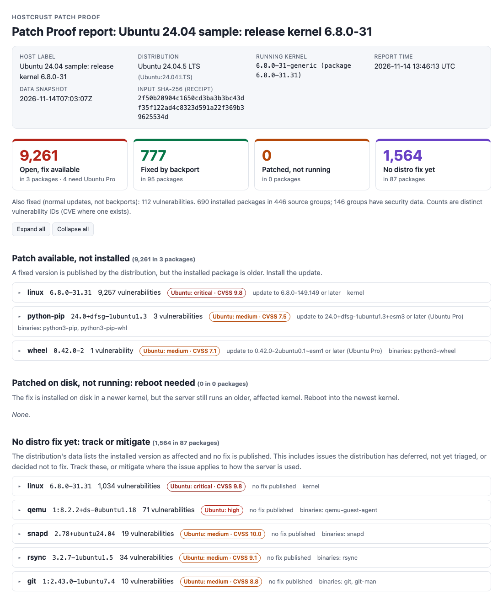

# HostCrust Patch Proof: which CVEs are really open on your Linux server?

**HostCrust Patch Proof shows which CVEs are really open on your Linux server, counting backported fixes and the running kernel.** It is a free, read-only command-line tool for Ubuntu, Debian, AlmaLinux and Rocky Linux. It installs nothing on the server, needs no root, and writes one self-contained HTML report.

## Install and run

```sh
pipx install git+https://github.com/HostCrust/patch-proof
hc-proof collect --script | ssh user@server sh -s | hc-proof report --input - --out report.html --label web-01
```

The first line installs the `hc-proof` command (Python 3.10 or newer, no dependencies; a PyPI release as `patch-proof` is coming). The second line pipes the read-only collector script to the server over SSH and builds the report on your machine. To read the script first, run `hc-proof collect --script`, or open [`collect.sh`](collect.sh). Already on the server? Run `hc-proof collect | hc-proof report --input - --out report.html`.



The screenshot is from [`samples/ubuntu-24.04-vm.html`](samples/ubuntu-24.04-vm.html). That is a real Ubuntu 24.04 VM with current user-space packages that was still running the 24.04 release kernel 6.8.0-31. Download the file and open it in a browser; GitHub shows HTML files as source.

## Why your scanner flags CVEs Ubuntu already fixed

1. Ubuntu and Debian fix most CVEs by patching the version they already ship ("backporting"), not by moving to the new upstream release.
2. Example: CVE-2024-6387 ("regreSSHion") was fixed upstream in OpenSSH 9.8p1. Ubuntu fixed it in `1:8.9p1-3ubuntu0.10` on 22.04 and in `1:9.6p1-3ubuntu13.3` on 24.04 ([ubuntu.com](https://ubuntu.com/security/CVE-2024-6387)).
3. A scanner that reads the version string sees "OpenSSH 8.9p1 (or 9.6p1) is older than 9.8p1" and reports the server as vulnerable.
4. This happens in practice. An Ubuntu 24.04 server running `1:9.6p1-3ubuntu13.11` was flagged for CVE-2024-6387. On Ubuntu Discourse, a moderator called it a false positive that the scanner vendor must fix ([thread](https://discourse.ubuntu.com/t/clarity-on-fix-for-cve-2024-6387-cve-2024-39894-on-24-04-2-lts/60283)).
5. HostCrust Patch Proof compares each installed package with the distribution's own fixed version. It labels such findings "Fixed by backport", next to the build that fixed them, so you can paste the evidence into the auditor's ticket.

## How it compares

We have **not** run these tools side by side. Every cell about another tool comes from that tool's own documentation, issue tracker or vendor pages, as linked, checked on 14 Nov 2026. "Not verified" means we found no source. All five tools do things this one doesn't (last row).

| | HostCrust Patch Proof | Trivy | Grype | Vuls | OpenSCAP + distro OVAL | Nessus |
|---|---|---|---|---|---|---|
| **Kernel CVEs vs the running kernel** | Yes. Judged against the running kernel's exact package version; a fix that is installed but not booted is reported as "patched on disk, not running" | Judges installed kernel packages; running-kernel detection is an open request ([#3764](https://github.com/aquasecurity/trivy/issues/3764)) | No running-kernel handling documented ([docs](https://oss.anchore.com/docs/guides/vulnerability/ecosystems/)) | Yes: collects `uname -r` and drops non-running kernel packages ([docs](https://vuls.io/docs/en/usage-server.html), [PR #1935](https://github.com/future-architect/vuls/pull/1935)) | Ubuntu's OVAL checks the running kernel ([Canonical, IRC log](https://irclogs.ubuntu.com/2022/11/28/%23ubuntu-security.txt)); other distros not verified | Debian: running kernel since March 2024 ([plugin changelog](https://www.tenable.com/plugins/nessus/136124/changelog)); others not verified |
| **Backported fixes** | Uses the distro's data; each backport finding names the older affected build of the same upstream version | Trusts the OS vendor's advisory ([docs](https://github.com/aquasecurity/trivy/blob/v0.76.2/docs/guide/scanner/vulnerability.md)); per-finding explanation not verified | Uses distro security feeds for OS packages ([docs](https://oss.anchore.com/docs/guides/vulnerability/ecosystems/)); explanation not verified | Uses the Debian, Ubuntu and Red Hat trackers ([docs](https://vuls.io/docs/en/main-features.html)); explanation not verified | Definitions are the vendor's own data ([ubuntu.com](https://ubuntu.com/security/oval)); explanation not verified | Local checks follow vendor advisories; remote banner checks depend on the "report accuracy" setting ([docs](https://docs.tenable.com/nessus/Content/AssessmentSettings.htm)) |
| **What runs on the server** | A read-only `sh` script over SSH; no install, no root | The Trivy binary, on the host (`trivy rootfs`) ([docs](https://github.com/aquasecurity/trivy/blob/v0.76.2/docs/guide/target/rootfs.md)) | The Grype binary, on the host (`grype dir:/`) ([docs](https://oss.anchore.com/docs/guides/sbom/scan-targets/)) | Agentless over SSH; fast mode needs no root ([docs](https://vuls.io/docs/en/architecture-fast-scan.html)); the scanning machine needs local databases ([guide](https://github.com/scaleway/docs-content/blob/main/tutorials/vuls-security-scanner/index.mdx)) | `oscap` must be installed on the target ([manual](https://static.open-scap.org/openscap-1.4.1/oscap_user_manual.html)) | Credentialed SSH as root, or the Nessus Agent ([docs](https://docs.tenable.com/nessus/Content/CredentialedChecksOnLinux.htm)) |
| **Ubuntu Pro (ESM) fixes** | Read; a fix that ships only in Ubuntu Pro is labelled as such, even on hosts without Pro | Ubuntu 20.04 ESM since 2025 ([#8978](https://github.com/aquasecurity/trivy/issues/8978)); other releases not verified | When ESM is enabled on the scanned host, since July 2026 ([PR #3546](https://github.com/anchore/grype/pull/3546)) | Supported; open bug: installed ESM builds still reported unfixed ([#2645](https://github.com/future-architect/vuls/issues/2645)) | Ubuntu OVAL includes ESM fixes ([ubuntu.com](https://ubuntu.com/security/oval)) | ESM plugins exist ([example](https://www.tenable.com/plugins/nessus/173437)) |
| **HTML report** | One self-contained file, no network requests; JSON too | Yes, bundled template ([docs](https://github.com/aquasecurity/trivy/blob/v0.76.2/docs/guide/configuration/reporting.md)) | Through a template; the example loads scripts from CDNs ([templates](https://github.com/anchore/grype/blob/main/templates/README.md)) | No HTML output; TUI and a separate web UI ([docs](https://vuls.io/docs/en/vulsrepo.html)) | Yes, `--report` ([ubuntu.com](https://ubuntu.com/security/oval)) | Yes ([docs](https://docs.tenable.com/nessus/Content/CreateAScanReport.htm)) |
| **Debian, Ubuntu, AlmaLinux, Rocky** | All four (versions listed below) | All four ([coverage](https://github.com/aquasecurity/trivy/blob/v0.76.2/docs/guide/coverage/os/index.md)) | All four ([docs](https://oss.anchore.com/docs/capabilities/all-os/)) | All four ([docs](https://vuls.io/docs/en/supported-os.html)) | One feed per distro; Rocky's OVAL files reported stale ([forum](https://forums.rockylinux.org/t/rocky-linux-oval-files-stopped-in-2024/18031)) | All four ([plugin families](https://www.tenable.com/plugins/nessus/families)) |
| **Where they do more** | Distro packages on one Linux host only | Container and VM images, Kubernetes, language packages, SBOM, IaC, secrets ([README](https://github.com/aquasecurity/trivy/blob/v0.76.2/README.md)) | Images, filesystems, SBOMs, language packages, EPSS and KEV risk data ([README](https://github.com/anchore/grype/blob/main/README.md)) | FreeBSD, Windows, macOS, language libraries, WordPress, exploit data, processes needing a restart ([docs](https://vuls.io/docs/en/main-features.html)) | Configuration compliance profiles ([manual](https://static.open-scap.org/openscap-1.4.1/oscap_user_manual.html)) | Network and remote checks, compliance audits, far beyond Linux ([docs](https://docs.tenable.com/nessus/Content/CredentialedChecksOnLinux.htm)) |

## How results are classified

For each installed package and each vulnerability in the distribution's data for it:

| Class | Rule | Report label |
|---|---|---|
| Open, fix available | The installed version is inside an affected range and a fixed version exists | Patch available, not installed |
| Fixed by backport | Installed >= the distribution's fixed version; the fix shipped as a distro revision of an upstream version the distribution had already shipped (an older build of the same `epoch:upstream` version is in the data as affected or fixed); and the server runs that same upstream version | Fixed: a scanner that reads version strings may still flag this |
| Fixed, normal | Installed >= fixed version, not a backport (for example, the fix came with a new upstream release) | Counted in the summary only |
| No fix yet | Affected, and the distribution has no fixed version | No distro fix yet: track or mitigate |
| Installed but not running | Kernel only: the running kernel is affected and a newer installed kernel is fixed. The reboot-required flag and its package list are shown too | Patched on disk, not running: reboot needed |

Packages are matched on the **source package** for Debian and Ubuntu, and on the **binary package** for AlmaLinux and Rocky Linux, because that is how each distribution publishes its data. Details that keep the report honest:

- **Version comparison** is a pure-Python implementation of dpkg's and rpm's ordering rules ([`hcproof/versions.py`](hcproof/versions.py)). It is tested against the shared vectors in [`tests/vectors/`](tests/vectors/): epochs, `~`, `^`, `+deb12u1`, `ubuntu0.24.04.1`, `.el9_4`, `+esm1`, module builds and more.
- **One row per CVE.**
  - Ubuntu's per-CVE records decide; USN numbers are shown as advisory links.
  - Debian's per-CVE records take precedence over DSA/DLA advisories, which are used where no per-CVE record exists.
  - AlmaLinux and Rocky Linux publish advisories only. When several advisories name the same CVE, one that says the installed version is fixed wins. So the report never says "vulnerable" against a distro statement that the issue is fixed.
- **Ubuntu Pro.** For Ubuntu LTS the Ubuntu Pro (ESM) data is read too. A fix that exists only in Ubuntu Pro is reported as "Patch available" with the note "Fix available with Ubuntu Pro (ESM)".
- **Kernel.** Kernel CVEs are checked against the running kernel. Its exact package version comes from `/proc/version_signature` on Ubuntu and from `uname -v` on Debian. Other packages built from the kernel source (headers, `linux-libc-dev`, tools) are not reported separately.
- **Third-party builds** are listed as "not assessed", because the distribution's fix data does not describe them. These include deb.sury.org PHP, the MariaDB and NodeSource repositories, nginx.org, PGDG, PPAs, Debian backports, and rpm packages from another vendor.
- **Severity** is the distribution's own rating (Ubuntu priority, Debian urgency, AlmaLinux/Rocky advisory severity) plus the CVSS v3 base score computed from the vector in the data. Records with only a CVSS v4 vector show no score. This tool rates nothing itself.
- **RPM module streams:** fixes for a different stream (major version) are not compared.

## FAQ

### How can I check which CVEs are really unpatched on my Ubuntu server?

Run the two commands under [Install and run](#install-and-run). The report puts every CVE that Ubuntu's data lists for your installed packages into one of the five classes above. Only "Patch available, not installed" and "Patched on disk, not running" need action from you, and each comes with the fixed version. It reads Ubuntu's own per-CVE data (through OSV.dev), so fixes Ubuntu backported count as fixed. To check one CVE by hand instead, look it up on `https://ubuntu.com/security/CVE-YYYY-NNNN` and compare the "Fixed in" version for your release with `dpkg-query -W -f='${Version}\n' <package>`. On a machine attached to Ubuntu Pro you can also run `pro fix CVE-YYYY-NNNN`.

### Why does my vulnerability scanner report CVEs that Ubuntu or Debian already fixed?

There are three common causes:

1. **The scanner compares upstream version numbers.** Ubuntu and Debian backport fixes into the version they ship, so `openssh 1:9.2p1-2+deb12u3` is fixed for CVE-2024-6387 even though 9.2p1 is older than the upstream fix in 9.8p1 ([Debian tracker](https://security-tracker.debian.org/tracker/CVE-2024-6387)). See [the section above](#why-your-scanner-flags-cves-ubuntu-already-fixed).
2. **It checks installed kernel packages, not the running kernel.** The opposite mistake happens too: a fixed kernel is installed but the server never rebooted into it.
3. **The fix exists only in Ubuntu Pro (ESM)**, and the host is not attached to Pro.

HostCrust Patch Proof labels each of these separately: "Fixed by backport", "Patched on disk, not running" and "Fix available with Ubuntu Pro (ESM)".

### Is CVE-2024-6387 fixed in Ubuntu 22.04?

Yes. Ubuntu fixed CVE-2024-6387 ("regreSSHion") on 22.04 LTS in `openssh 1:8.9p1-3ubuntu0.10` ([ubuntu.com](https://ubuntu.com/security/CVE-2024-6387)). Your server is fixed if `dpkg-query -W -f='${Version}\n' openssh-server` prints that version or a later one. Ubuntu 24.04 is fixed in `1:9.6p1-3ubuntu13.3`. Ubuntu 20.04 was never affected: the bug was introduced in OpenSSH 8.5p1 (Ubuntu's notes on the same page), and 20.04 ships 8.2p1. More releases and distributions: [docs/cve-2024-6387.md](docs/cve-2024-6387.md).

### How do I check if my running kernel is vulnerable to CVE-2026-31431?

CVE-2026-31431 ("Copy Fail") is a Linux kernel local privilege escalation. Only the kernel you are **running** matters; a fixed kernel that is installed but not booted does not protect you. To check:

1. Print the running kernel with `uname -r`. On Ubuntu, also run `cat /proc/version_signature`, which shows the exact package version.
2. Compare that version with your distribution's fixed version. For the main `linux` package: Ubuntu 24.04 `6.8.0-117.117`, Ubuntu 22.04 `5.15.0-179.189`, Ubuntu 20.04 `5.4.0-230.250` (Ubuntu Pro only), Debian 12 `6.1.170-1`. Sources: [ubuntu.com](https://ubuntu.com/security/CVE-2026-31431) and the [Debian tracker](https://security-tracker.debian.org/tracker/CVE-2026-31431).
3. If the fixed kernel is installed but not running, reboot.

The report does this check for you: it shows the CVE as "Patched on disk, not running" until you reboot. Cloud, HWE, AlmaLinux and Rocky Linux kernels, and a Debian 11 data gap, are covered in [docs/cve-2026-31431.md](docs/cve-2026-31431.md).

## Supported systems

Debian 11 and 12; Ubuntu 20.04, 22.04 and 24.04 LTS; AlmaLinux 8 and 9; Rocky Linux 8 and 9. Debian 13, Ubuntu 26.04, AlmaLinux 10 and Rocky Linux 10 are accepted but untested.

## Commands

| Command | What it does |
|---|---|
| `hc-proof collect` | Runs the collector on this machine and prints its output. `--script` prints the script instead of running it. |
| `hc-proof report --input FILE --out report.html [--label NAME]` | Builds the report. `--input -` reads stdin, and `--json FILE` also writes JSON. The data source is chosen by the options below. |
| `hc-proof report ... --os ubuntu:24.04` | Degraded mode: reads a pasted `dpkg -l` or `rpm -qa` instead of collector output. Less accurate (see [Limits](#limits)). |
| `hc-proof index fetch --out index.sqlite` | Downloads and verifies the prebuilt index, then copies it to a file (for `--index`, or for other programs). |
| `hc-proof index build --out index.sqlite [--ecosystems ...]` | Builds the index yourself from OSV.dev data. See [INTEGRATION.md](INTEGRATION.md). |
| `hc-proof sanitise IN [OUT]` | Reduces collector output to package and OS data, for sharing. |

Where `report` gets its data:

| Option | Source | First run | Later runs |
|---|---|---|---|
| `--prebuilt` (default) | `index.sqlite.gz` from this repository's [`index-latest` release](https://github.com/HostCrust/patch-proof/releases/tag/index-latest), rebuilt daily from OSV.dev by [`.github/workflows/index.yml`](.github/workflows/index.yml). Checked against its published SHA-256 and cached for 24 hours | About 41 MB download | Cache only. After 24 h it downloads the small checksum file, and the index only if it changed |
| `--index-url URL` | The same, from your own mirror (`URL` plus `URL.sha256`). Also settable as `$HCPROOF_INDEX_URL` | Depends on the mirror | Same as above |
| `--osv` | Each distribution family's OSV bulk file, indexed locally | Ubuntu 816 MB and about 90 s of indexing; Debian 82 MB; AlmaLinux 7 MB; Rocky Linux 6 MB | Under a second |
| `--index FILE` | A local index file | None | None |

`--offline` never touches the network and uses whatever is cached. `--max-age HOURS` changes the 24-hour re-check interval. If the prebuilt index cannot be downloaded, or does not cover your release (for example Debian 13 or Ubuntu 26.04), `report` says so and falls back to `--osv`. With an explicit `--index-url` it stops with an error instead.

The SHA-256 check catches a truncated or corrupted download. It is not a signature: it does not protect against someone who can replace both files on the release. If that matters to you, run `hc-proof index build` yourself and use `--index`.

## The collector

[`collect.sh`](collect.sh) is a short POSIX `sh` script. It needs no root and no network, writes nothing, and prints only:

- `/etc/os-release`
- the running kernel (`uname -r`, `uname -v`, `uname -m`, and `/proc/version_signature` on Ubuntu), plus the names of the kernel images in `/boot`
- the reboot-required flag and the packages that asked for a reboot, where present
- the package list: from `dpkg-query` (status, name, version, architecture, source) or `rpm -qa` (name, epoch, version, release, architecture, source rpm, vendor)

It collects no hostname, IP address, user name or file contents (other than `/etc/os-release`). The report's header shows the SHA-256 of the input as a receipt.

## Limits

- **Distribution packages only.** No containers, images, language packages (pip, npm, gems), configuration, or exposure analysis. Use Trivy or Grype for those.
- **The data decides.** A result is only as current as the data snapshot, and the distribution's data decides what counts as affected and fixed.
- **Not a guarantee.** The report states what the distribution's data says about the installed versions, not that a server is safe.
- **Known data gaps (November 2026):**
  - **Debian 11** left Debian LTS in August 2026. OSV now has per-CVE data for only a small part of bullseye (about 1,200 entries, against about 62,000 for Debian 12), plus DSA/DLA advisories up to March 2026. Debian 11 results are incomplete, and the report says so.
  - **AlmaLinux and Rocky Linux** data lists released fixes only, so "No distro fix yet" cannot be reported for them.
  - **Rocky Linux** data covers fewer packages and CVEs than AlmaLinux data for the same RHEL release: about 4,600 CVEs over 1,900 package names for Rocky 9, against about 5,700 CVEs over 3,000 for AlmaLinux 9.
  - **Ubuntu** no-fix entries don't say whether Ubuntu's status is "vulnerable", "deferred", "needs evaluation" or "ignored"; all are shown as "No distro fix yet".
  - **Not covered:** Ubuntu FIPS, Realtime and BlueField kernels, and live kernel patching (Livepatch, kpatch).
- **Degraded mode.** A pasted `dpkg -l` has no source package names. Packages are then matched by binary name, and for Ubuntu also through the binary-to-source map in Ubuntu's data, so some issues will be missed (more on Debian than on Ubuntu). A pasted `rpm -qa` usually has no epochs, so versions are compared without them. The running kernel is unknown. The report states all of this; use the collector when you can.

How the results were checked against ubuntu.com and the Debian security tracker: [VERIFICATION.md](VERIFICATION.md).

## Data snapshot

The data is [OSV.dev](https://osv.dev) bulk data: one `all.zip` per distribution family, filtered to the release's ecosystem (`Debian:12`, `Ubuntu:24.04:LTS` plus `Ubuntu:Pro:24.04:LTS`, `AlmaLinux:9`, `Rocky Linux:9`, and so on). The per-release folders in the OSV bucket stopped updating in October 2024 and are not used.

- **Every report states its snapshot:** the Last-Modified time of the OSV file it was built from, plus that file's SHA-256 when known.
- **The prebuilt index** is rebuilt daily. Its release notes list each family's snapshot.
- **The tests and the samples** use the snapshots of 14 Nov 2026: Ubuntu 07:03:07 UTC and Debian 11:02:45 UTC.
- **Bulk data is never committed.** It lives in the user cache directory: `~/.cache/hcproof` on Linux, `~/Library/Caches/hcproof` on macOS, or `$HCPROOF_CACHE` if set.

## Development

```sh
python3 -m unittest discover -s tests -t .      # all tests, offline (a local HTTP server stands in for GitHub)
hc-proof index build --ecosystems Ubuntu:24.04:LTS Debian:12 --out /tmp/combined.sqlite
python3 -m tests.subset /tmp/combined.sqlite    # refresh the OSV slice used by the end-to-end tests
python3 -m tests.test_e2e --update              # then re-record expected counts, and re-check by hand
```

- **End-to-end tests** run two inventories from [`tests/fixtures/`](tests/fixtures/) against a 2.6 MB slice of real OSV data, and assert the hand-checked items in [VERIFICATION.md](VERIFICATION.md). The inventories are a real Ubuntu 24.04 VM, frozen on 14 Nov 2026, and a small synthetic Debian 12 inventory.
- **No run-time dependencies.** It needs only the Python 3.10+ standard library (`sqlite3`, `zipfile`, `gzip`, `json`, `urllib`).
- **Cross-checks.** During development the version vectors were also checked against `python-debian` and `rpm-vercmp`. Neither is needed to run or test.

See [CONTRIBUTING.md](CONTRIBUTING.md) and [SECURITY.md](SECURITY.md).

## License

Apache-2.0. See [LICENSE](LICENSE) and [NOTICE](NOTICE). The vulnerability data comes from OSV.dev and the distributions' security trackers under their own terms.

Want this every day for every server, with receipts? HostCrust (launching soon): https://hostcrust.com
